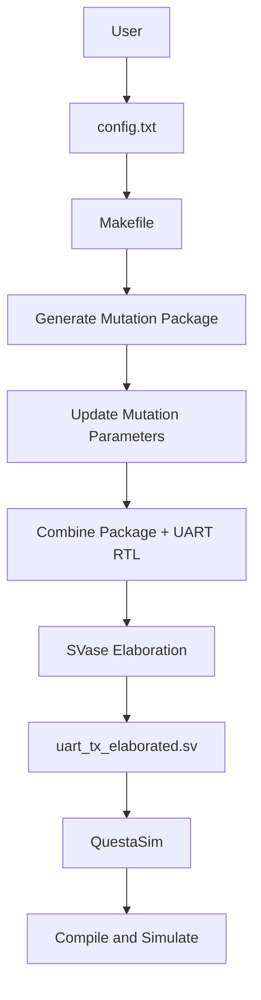

# UART RTL Mutation Launcher

A simple automated framework for activating RTL mutations, elaborating the selected design using **SVase**, and generating SystemVerilog RTL ready for QuestaSim simulation.

---

## 1. Project Overview

This tool allows users to select which mutations they want to activate in the UART transmitter design.

Instead of manually modifying the RTL, users only need to:

1. Configure the desired mutations.
2. Run the Makefile.
3. Let SVase elaborate the selected design.
4. Compile the generated RTL in QuestaSim.

### How the Project Works

The following diagram illustrates the complete workflow:



### Project Architecture

```text
UART-Mutation-Launcher/
│
├── Makefile
│
├── config.txt
│
├── mutdef.txt
│
├── mutation_defult.sv
│
├── mutations.sv
│
├── mut.txt
│
├── uart_tx.sv
│
└── uart_tx_elaborated.sv       # Generated output
```

| File | Purpose |
|---|---|
| `Makefile` | Automates mutation configuration and SVase execution. |
| `config.txt` | User-defined mutation selection. |
| `mutdef.txt` | Default mutation parameter definitions. |
| `mutation_defult.sv` | Generated package containing mutation parameters. |
| `mutations.sv` | Generated mutation configuration package. |
| `mut.txt` | Intermediate configuration file. |
| `uart_tx.sv` | Original UART transmitter RTL. |
| `uart_tx_elaborated.sv` | Final elaborated RTL generated by SVase. |

---

## 2. Requirements and Dependencies

Before using the tool, install the following software.

| Software | Required for |
|---|---|
| Windows 10/11 | Host operating system |
| WSL2 | Running the Linux environment |
| Ubuntu 24.04 | Recommended Linux distribution |
| Git | Downloading SVase |
| GNU Make | Running the automation script |
| GCC / G++ | Building SVase |
| CMake | Building SVase |
| Python 3 | SVase build dependencies |
| QuestaSim | RTL compilation and simulation |

**Important:** QuestaSim is not required to generate the elaborated RTL. It is only needed for subsequent compilation and simulation.

---

## 3. Step 1 – Set Up Ubuntu on WSL2

If WSL2 and Ubuntu are not already installed, open Windows PowerShell as Administrator and execute:

```powershell
wsl --install -d Ubuntu-24.04
```

Restart Windows if requested, then open Ubuntu.

Update Ubuntu:

```bash
sudo apt update
sudo apt upgrade -y
```

Install the required development tools:

```bash
sudo apt install -y \
    build-essential \
    cmake \
    git \
    make \
    python3 \
    python3-pip \
    pkg-config
```

Verify the installations:

```bash
gcc --version
g++ --version
cmake --version
git --version
make --version
python3 --version
```

---

## 4. Step 2 – Install SVase

SVase is the SystemVerilog source-to-source elaboration tool used by this project.

Clone the official repository:

```bash
cd /root

git clone --recursive https://github.com/pulp-platform/svase.git
```

Enter the SVase directory:

```bash
cd /root/svase
```

Build the tool:

```bash
make build
```

After a successful build, verify the executable:

```bash
./build/svase --help
```

The expected executable path is:

```text
/root/svase/build/svase
```

**Low-memory systems:** If the Slang dependency fails because of memory exhaustion, build it with one job:

```bash
cmake --build deps/slang/build -j1
```

Then continue the SVase build using the repository's build instructions.

---

## 5. Step 3 – Prepare the UART Project

Make sure the project files are available in your Windows project directory.

For example:

```text
D:\NVDLA\UART\UART\
```

From Ubuntu, access the same directory using:

```bash
cd /mnt/d/NVDLA/UART/UART
```

Verify the required files:

```bash
ls
```

The directory should contain at least:

```text
Makefile
config.txt
mutdef.txt
uart_tx.sv
```

### Important Package Configuration

The mutation definition package must use the same package name imported by the UART RTL.

The expected package declaration is:

```systemverilog
package mut_def;
```

And the UART RTL should import:

```systemverilog
import mut_def::*;
```

Make sure these names match before running the tool.

### Configure the Paths

The supplied Makefile currently expects:

```text
SVase:
    /root/svase

UART project:
    /mnt/d/NVDLA/UART/UART
```

If your project is located elsewhere, update the corresponding paths in the Makefile before proceeding.

---

## 6. Step 4 – Select the Mutations

Open:

```text
config.txt
```

This file controls which mutations are activated.

Each mutation is represented by a parameter:

- `0` – Mutation disabled.
- `1` – Mutation enabled.

For example, the following parameter values represent a configuration with selected mutations enabled:

```systemverilog
parameter m0 = 0;
parameter m1 = 1;
parameter m2 = 0;
parameter m3 = 1;
```

The actual `config.txt` format must follow the configuration format supplied with the project.

**What happens next?**

The Makefile reads the configuration and updates the corresponding mutation parameters in `mutation_defult.sv`.

You do not need to edit the UART RTL manually to activate the configured mutations.

---

## 7. Step 5 – Launch the Mutation and Elaboration Flow

Once the configuration is ready, open Ubuntu and navigate to the project directory:

```bash
cd /mnt/d/NVDLA/UART/UART
```

Execute:

```bash
make build
```

The Makefile automatically performs the following operations:

**Phase A – Mutation Configuration**

1. Generate `mutation_defult.sv` from `mutdef.txt`.
2. Generate `mutations.sv`.
3. Read the selected mutation values from `config.txt`.
4. Update the mutation parameters.

**Phase B – RTL Preparation**

5. Combine `mutation_defult.sv` and `uart_tx.sv`.
6. Generate the input source file for SVase.

**Phase C – Elaboration**

7. Execute SVase with `uart_tx` as the top module.
8. Evaluate the selected elaboration configuration.
9. Generate the elaborated RTL output.

The complete process is launched using a single command:

```bash
make build
```

---

## 8. Step 6 – Locate the Generated RTL

After successful elaboration, the output file is:

```text
uart_tx_elaborated.sv
```

The default output location is:

```text
D:\NVDLA\UART\UART\uart_tx_elaborated.sv
```

Since the output is generated directly inside the Windows-mounted project directory, you can open it immediately from Windows.

### Expected SVase Execution Stages

A successful execution should display stages similar to:

```text
PREPROCESS
PARSE
COMPILE
REWRITE
REWRITE [after recompilation]
POSTPROCESS
WRITEOUT
DONE
```

The final `DONE` message indicates that SVase completed its elaboration process.

---

## 9. Step 7 – Compile the Generated RTL in QuestaSim

Open QuestaSim on Windows.

Navigate to the project directory:

```tcl
cd D:/NVDLA/UART/UART
```

Compile the generated SystemVerilog file:

```tcl
vlog -sv uart_tx_elaborated.sv
```

Check the module declaration inside the generated file before using it in your testbench. SVase may generate a uniquified module name.

After successful compilation, compile your testbench and run your simulation normally.

---

## 10. Step 8 – Restore the Default Configuration

To restore the default mutation definition, execute:

```bash
make clean
```

This copies the original definition from `mutdef.txt` into `mutation_defult.sv`.

You can then configure a different mutation set in `config.txt` and run the launcher again.

---

## 11. Complete User Workflow

Once the initial installation and path configuration are complete, the normal usage process is:

```text
1. Open config.txt
        |
        v
2. Select mutations (0 or 1)
        |
        v
3. Open Ubuntu / WSL
        |
        v
4. Navigate to the project directory
        |
        v
5. Execute: make build
        |
        v
6. Wait for SVase to finish
        |
        v
7. Open uart_tx_elaborated.sv in QuestaSim
        |
        v
8. Compile and simulate
```

**That's it!** Mutation selection and RTL elaboration are automated through the provided Makefile.

---

## 12. Troubleshooting

| Problem | Suggested solution |
|---|---|
| `make: command not found` | Install GNU Make using `sudo apt install make`. |
| `SVase executable not found` | Build SVase and verify `/root/svase/build/svase`. |
| `missing separator` | Ensure Makefile commands start with TAB characters. |
| `unknown package 'mut_def'` | Check that the package declaration and RTL import names match. |
| `SVase compilation error` | Check the mutation package and combined input source. |
| Output file not found | Verify the configured Windows output directory. |
| QuestaSim compilation error | Inspect the generated module declaration and compilation messages. |

---

## References

- [SVase – Official GitHub Repository](https://github.com/pulp-platform/svase)
- [Microsoft – Install WSL](https://learn.microsoft.com/en-us/windows/wsl/install)
- [QuestaSim Documentation](https://eda.sw.siemens.com/en-US/ic/questa/)